# PING OS-1

A four-track rhythm synthesis engine for the M-VAVE FM-1, by PING AUDIO (ping.audio). Version 1.0.0.

- **69 sound models**: 49 drums and 20 synths, plus a supplemental sampler and granular engine
- **23 effects**, four on every track and four on the master, each drawn live on the screen
- **A step sequencer** with eight note lanes a track, parameter locks, ratchets, chance, ties and micro timing
- **A line generator and an autopilot**: one writes bass lines and melodies in key, the other keeps varying a playing pattern
- **Key lock**: one key and scale for every track
- **Four modulators** a track and four macros
- **16 patterns** a project, chained in song mode, and 16 sound presets
- **Performance mode**, a 3D visualizer and a custom theme colour
- **A VST3 plugin** with the same engine, and a browser page to try it, install it, load samples and record

## Quick start

1. **Install.** Connect the FM-1 by USB, open the PING OS-1 page in Chrome or Edge, accept the terms and press Install.
2. **Play.** Press <kbd>PLAY</kbd>. The factory project starts: a drum kit and three synths at 130 BPM, with three patterns to try (hold <kbd>HOME</kbd> and press white key 1, 3 or 4).
3. **Pick a track.** Turn <kbd>PRESETS</kbd>, or press black keys 1 to 4. The top line shows T1 to T4.
4. **Add steps.** The sixteen white keys are the steps of the chosen track. Tap one to set it, tap again to clear it.
5. **Shape the sound.** Press <kbd>EDIT</kbd>. <kbd>K1</kbd> to <kbd>K4</kbd> are the four knobs on the screen and <kbd>SELECT</kbd> turns the pages.
6. **Change the sound.** Press <kbd>SEL</kbd> for the BROWSER, turn <kbd>SELECT</kbd> through every engine and model while it plays, and press <kbd>SAVE</kbd> to keep one.
7. **Add an effect.** Press <kbd>FX</kbd>, turn <kbd>ALGO</kbd> to choose one, and set it with <kbd>K1</kbd> to <kbd>K4</kbd>.
8. **Write notes.** Press <kbd>SEQ</kbd> for the STEP view. Black keys 1 to 8 choose a note lane, white keys set steps on it.
9. **Mix.** Press <kbd>GLO</kbd>. The first pages are level, pan and filter for the four tracks.
10. **Save.** Hold <kbd>SAVE</kbd> until the screen says SAVED. A tap on <kbd>SAVE</kbd> opens the LIBRARY instead.
11. **Lost?** Hold <kbd>GLO</kbd> and press <kbd>SAVE</kbd> for HELP: press any control and the screen says what it does.

## How it fits together

A **track** is one sound engine, then four effect slots, then its level, pan and filter in the mix. Each track has its own pattern, four modulators and sends. The four tracks meet in the **master chain**: four more effects and a limiter.

A **pattern** is the steps of all four tracks. A **project** holds sixteen patterns, a song that chains them, sixteen sound presets, the mix and the master chain.

Each button opens one screen. Every screen uses the same four knobs, <kbd>K1</kbd> to <kbd>K4</kbd>, for the four tiles it shows, and <kbd>SELECT</kbd> for its pages.

| Press | Screen | What it is for |
|---|---|---|
| <kbd>HOME</kbd> | TRACKS | All four patterns at once. The white keys are steps. |
| <kbd>SEQ</kbd> | STEP | One track in detail: eight note lanes, per-step settings, locks. |
| <kbd>EDIT</kbd> | EDIT | The engine of the track: its sound. |
| <kbd>SEL</kbd> | BROWSER | Choose an engine, model, preset or effect by ear. |
| <kbd>FX</kbd> | FX 1 to 4 | The four effect slots of the track. |
| <kbd>LFO</kbd> | MOD | The four modulators of the track. |
| <kbd>ARP</kbd> | LINE | The line generator: writes a bass line or melody. |
| <kbd>GLO</kbd> | Global pages | Key, tempo, mix, sends, song, autopilot, setup, display. |
| <kbd>GLO</kbd> + <kbd>FX</kbd> | MASTER | The master effects. |
| <kbd>HOME</kbd> + <kbd>FX</kbd> | PERFORM | The master effects on four knobs, for playing live. |
| <kbd>GLO</kbd> + <kbd>HOME</kbd> | SPECTRUM | A 3D picture of the sound. |
| <kbd>SAVE</kbd> | LIBRARY | Sounds, patterns and the project, saved and loaded. Hold <kbd>SAVE</kbd> to save the project at once. |
| <kbd>OCT-</kbd> + <kbd>OCT+</kbd> | MACROS | Four knobs that each move several settings. |
| <kbd>GLO</kbd> + <kbd>EDIT</kbd> | LOAD | How hard the processor is working. |
| <kbd>GLO</kbd> + <kbd>SAVE</kbd> | HELP | What every control does. |

## The panel

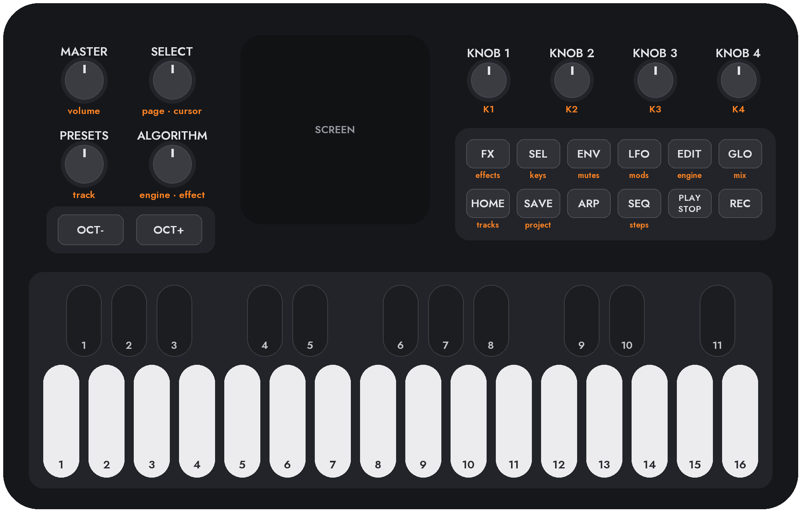

| Control | What it does |
|---|---|
| <kbd>SELECT</kbd> | Turns the pages. In the sequencer, moves the step cursor. |
| <kbd>ALGORITHM</kbd> | Chooses the engine on EDIT, the effect in an FX slot, the track in TRACKS. Written <kbd>ALGO</kbd> below. |
| <kbd>PRESETS</kbd> | Chooses the track, T1 to T4. |
| <kbd>KNOB 1</kbd> to <kbd>KNOB 4</kbd> | The four tiles on the screen, left to right. Written <kbd>K1</kbd> to <kbd>K4</kbd> below. |
| <kbd>MASTER</kbd> | Volume. |
| <kbd>SEQ</kbd> | Also the shift key: held with a knob it changes that knob's mode. |
| <kbd>ENV</kbd> | Tap: the keys play notes instead of steps. Held: white keys 1 to 4 mute a track, black keys 1 to 4 solo it. |
| <kbd>REC</kbd> | Live record. Held with steps: parameter locks. Held and let go alone: the metronome. |
| <kbd>OCT-</kbd> <kbd>OCT+</kbd> | The keyboard an octave down or up. |
| Keys | White keys are steps, or notes after a tap on <kbd>ENV</kbd>. C4 is the sound as tuned. |

Every knob follows how fast it is turned: slowly, a click is 1 % for exact values; quickly, a half turn crosses the whole range.

## The screen

<table><tr><td align="center">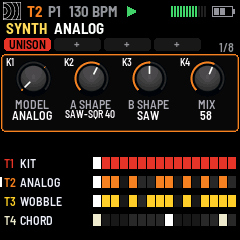 The EDIT page of a synth track.</td></tr></table>

Every page has the same frame.

- **Top line:** the track, the pattern, the tempo, play or stop, the output meter and the battery.
- **Slot row:** the engine and the four effect slots, the open one lit, and the page number on the right.
- **Tiles:** the four settings on <kbd>K1</kbd> to <kbd>K4</kbd>, each with its name and value. A teal bar over a tile shows a modulator moving it.
- **A word under a value** is a mode. Hold <kbd>SEQ</kbd> and turn that knob to change it.
- **Bottom:** the four tracks with their steps and the playhead.

## TRACKS

<table><tr><td align="center">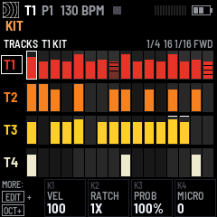 TRACKS: the four patterns.</td><td align="center">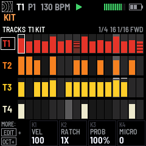 Playing.</td></tr></table>

<kbd>HOME</kbd> shows all four tracks, a row each, with every lane merged into one row of steps.

- White keys set and clear steps on the chosen track.
- Black keys 1 to 4, <kbd>ALGO</kbd> or <kbd>PRESETS</kbd> choose the track.
- Hold a step and turn <kbd>K1</kbd> to <kbd>K4</kbd> for its VELOCITY, RATCHET, CHANCE and MICRO timing, as in the STEP view.
- Hold <kbd>HOME</kbd> and press a white key to change pattern.
- Hold <kbd>SEQ</kbd> and turn <kbd>ALGO</kbd> for the tempo.

How steps are drawn: the bar is as tall as the velocity and as wide as the gate. A ratchet cuts the bar into its hits. A step fades with its CHANCE. Tied steps are chequered. A step with a lock carries a dot.

## The STEP view

<table><tr><td align="center">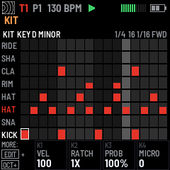 The STEP view of a KIT: a drum on each lane.</td><td align="center">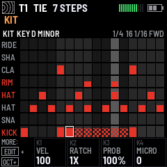 A tie: chequered after its first step.</td></tr></table>

<kbd>SEQ</kbd> opens one track: eight note lanes, sixteen steps a page, up to four pages (64 steps). On a synth the lanes are the notes of the track's scale. On a KIT each lane is a drum.

| Do this | To get this |
|---|---|
| Black keys 1 to 8 | Choose a lane and hear it. |
| White keys | Set or clear a step on that lane. |
| Hold a step, turn <kbd>K1</kbd> to <kbd>K4</kbd> | VELOCITY, RATCHET (1 to 4 hits, and four rolls), CHANCE, MICRO timing (up to half a step early or late). |
| <kbd>EDIT</kbd> + <kbd>OCT+</kbd> | The second page of step knobs: OCTAVE, SEND (this hit alone into the master effects; on a KIT the whole kit on that step, so every drum on it is striped), CYCLE (plays on pass A of every B), GATE (note length). <kbd>EDIT</kbd> + <kbd>OCT-</kbd> goes back. |
| Hold a step, press black keys | A chord: those lanes on the same step. |
| Hold a step a moment, tap a later one | A tie: one long note. |
| <kbd>SEL</kbd> held on a step + <kbd>SELECT</kbd> or <kbd>ALGO</kbd> | Move the step along its lane, or to another lane. |
| <kbd>SEQ</kbd> + <kbd>K1</kbd> to <kbd>K4</kbd> | The track's LENGTH, RATE, DIRECTION (forward, reverse, pendulum, random) and SWING. |
| <kbd>SEQ</kbd> + <kbd>SELECT</kbd> | The page of steps. |
| <kbd>SEQ</kbd> + <kbd>ALGO</kbd> | The track's scale. |
| <kbd>EDIT</kbd> + <kbd>ALGO</kbd>, <kbd>EDIT</kbd> + <kbd>SELECT</kbd> | The track's own key and scale, over the master key. |
| <kbd>EDIT</kbd> + <kbd>PRESETS</kbd> | All lanes up or down a semitone, or a scale step. |
| <kbd>OCT-</kbd> <kbd>OCT+</kbd> | All lanes an octave. |
| <kbd>SEQ</kbd> + <kbd>EDIT</kbd> | LANE NOTES: set each lane's note by hand. |
| <kbd>SEQ</kbd> + white 12 to 16 | Generators: a melody, a beat, random locks, random lanes, a variation. |
| <kbd>SEQ</kbd> + <kbd>REC</kbd> | Clear the track. |
| <kbd>EDIT</kbd> + <kbd>REC</kbd> | Undo the last generator, clear or shift. Again: redo. |

### Live recording

Tap <kbd>ENV</kbd> so the keys play notes, press <kbd>REC</kbd>, then <kbd>PLAY</kbd>. A bar is counted in and what you play is written at the playhead. The SETUP page under <kbd>GLO</kbd> sets the count-in (off, one bar, two bars) and MICRO: on, each note keeps the exact timing you played inside its step.

### Parameter locks

<table><tr><td align="center">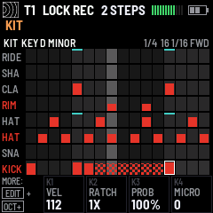 Two steps armed.</td><td align="center">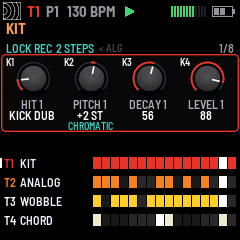 A knob turned now is locked on those steps.</td></tr></table>

A lock is a knob setting that belongs to one step. Hold <kbd>REC</kbd> and press steps to arm them, then turn any knob on an EDIT or FX page: it changes on those steps only. The model can be locked too, so one track can be a kick, a snare and a hat. Tap <kbd>REC</kbd> to finish. Thirty-two locks a track a pattern.

## EDIT: the sound

<table><tr><td align="center">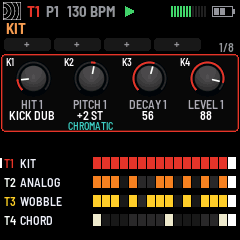 A KIT: part 1, the kick.</td><td align="center">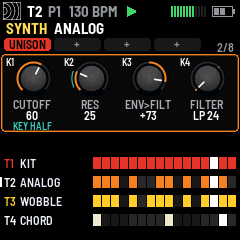 ANALOG, the filter page.</td></tr></table>

<kbd>EDIT</kbd> opens the engine of the track. <kbd>ALGO</kbd> chooses the engine, <kbd>K1</kbd> is usually the model, <kbd>SELECT</kbd> turns the pages. Hold <kbd>EDIT</kbd> to switch the engine off and on.

| Engine | What it is |
|---|---|
| KIT | Eight drums on one track, one on each lane. Each part has its own model, pitch, decay and level. The closed hat chokes the open one. |
| DRUM | One of 49 drum models, played across the lanes as notes. |
| SYNTH | One of 20 synth models, from a full subtractive synth to FM, strings, bells and an acid bass. |
| SAMPLE | One of the eight samples you loaded, with start, length, loop, envelope and filter. |
| GRAIN | A sample played as a cloud of grains while a note is held: position, size, density, spray. |

Every model and effect is listed under Models and effects, near the end.

Choosing a model sets every knob to a sound that works. Most synth models have three knobs of their own, then a shared filter (CUTOFF, RES, ENV>FILT), envelopes, PITCH, GLIDE, LEVEL and VELOCITY.

- **MODE** is how a note ends: GATE (held as long as the key or step, the default), PING (rings out) or DRONE (never stops).
- **VOICES** is how many notes sound at once: 4, 2, 1 or LEGATO. Fewer voices leave more processor time.
- **KEY TRACK:** hold <kbd>SEQ</kbd> and turn CUTOFF to make the filter follow the note: OFF, HALF or FULL.
- **PITCH** moves in semitones, in scale steps, or freely: hold <kbd>SEQ</kbd> and turn it to choose.

### ANALOG

A full subtractive synth on eight pages. Two oscillators whose SHAPE runs from sine through triangle, saw and square to pulse; a sine SUB; NOISE; a ladder filter with four types (LP 24, LP 12, BAND, HIGH); two ADSR envelopes, one for level and one for the filter; SYNC; and COLOR, one knob from exact and clean to worn and driven.

### ACID and WOBBLE

ACID is a one-voice acid bass: notes over velocity 100 are accented and a note tied into the next one slides. WOBBLE is ANALOG with a filter sweep locked to the tempo: RATE, DEPTH and SHAPE set the sweep.

### Layouts

<table><tr><td align="center">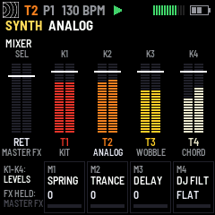 MIXER.</td><td align="center">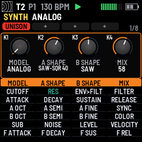 PANEL: every page at once.</td></tr></table>

Tap <kbd>EDIT</kbd> again to go round three layouts of the page: the knobs over the four tracks; MIXER, tall meters with the track levels on <kbd>K1</kbd> to <kbd>K4</kbd> and the master effects below; and PANEL, every page of the engine at once.

### The envelope display

<table><tr><td align="center">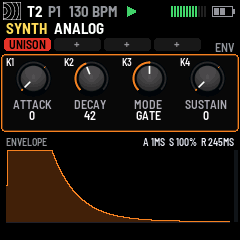 SEQ + ENV: the amp envelope.</td></tr></table>

<kbd>SEQ</kbd> + <kbd>ENV</kbd> draws the envelope under the knobs, with its stages on <kbd>K1</kbd> to <kbd>K4</kbd>. On a synth, the same again shows the filter envelope; once more closes it.

## The BROWSER

<table><tr><td align="center">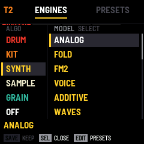 Engines on the left, models on the right.</td></tr></table>

<kbd>SEL</kbd> opens a full-screen list of what the track can hold. The line you are on plays at once, so you choose by ear.

- <kbd>SELECT</kbd> runs through every model of every engine. <kbd>ALGO</kbd> jumps between engines.
- <kbd>EDIT</kbd> switches to the PRESETS tab, your sixteen saved sounds.
- <kbd>SAVE</kbd> keeps the choice. <kbd>SEL</kbd> or <kbd>HOME</kbd> closes the page and puts the track back as it was.
- Opened from an FX slot, it lists the effects instead.

## Effects

<table><tr><td align="center">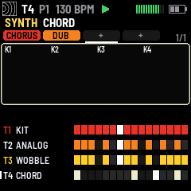 An empty slot.</td><td align="center">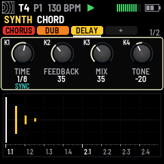 DELAY, with its taps drawn.</td><td align="center">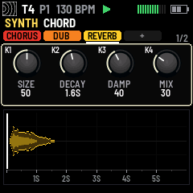 REVERB.</td></tr></table>

<kbd>FX</kbd> steps through the four slots of the track. <kbd>ALGO</kbd> chooses the effect, <kbd>SELECT</kbd> turns its pages, and holding <kbd>FX</kbd> bypasses the slot. They run in order, 1 to 4. Any effect can go in any slot, and each one draws what it is doing.

All 23 are listed, with a line on each, under Models and effects below.

Delays and reverbs share a pool of memory. If it runs out, a slot says NO MEMORY and passes the sound dry.

## Modulation

<table><tr><td align="center">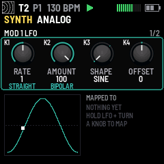 MOD 1, an LFO.</td><td align="center">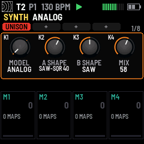 The four macros.</td></tr></table>

<kbd>LFO</kbd> opens the modulators of the track. There are four; hold <kbd>LFO</kbd> and press white keys 1 to 4 to choose one. Each is an LFO or a TRIG RND, a new random value on every note.

- **To map one:** hold <kbd>LFO</kbd> and turn any knob on any page. How far you turn is the depth, up or down.
- **LFO settings:** RATE (free or synced), AMOUNT, SHAPE, OFFSET, then PHASE, SKEW, SMOOTH and SPREAD.
- **Polarity:** hold <kbd>SEQ</kbd> and turn AMOUNT for BIPOLAR (both ways) or UNIPOLAR (one way), on an LFO or a TRIG RND.
- **To clear:** <kbd>LFO</kbd> + <kbd>REC</kbd> clears every mapping of the chosen modulator.
- Track level, pan and mix filter can be mapped too, from their <kbd>GLO</kbd> pages.

### Macros

Four macros are shared by all tracks. Press <kbd>OCT-</kbd> and <kbd>OCT+</kbd> together and <kbd>K1</kbd> to <kbd>K4</kbd> become the macros; press both again to get the knobs back. To assign one, hold both OCT buttons and press white key 1 to 4, let go, turn the knobs it should move, then press both again.

## The line generator

<table><tr><td align="center">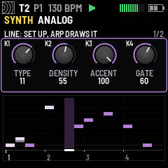 LINE: the generator and the line it drew.</td></tr></table>

<kbd>ARP</kbd> opens the generator. A second tap writes a line into the chosen track, in its key; every tap after that writes a new one. Hold <kbd>ARP</kbd> from any other screen to write one without leaving it.

- **TYPE** runs from all random notes to nearly all root notes. **DENSITY** is how many steps play.
- **ACCENT** and **GATE** set how hard the accents hit and how long the notes are.
- The knobs reshape the line that is there; <kbd>ARP</kbd> draws a fresh one.
- White keys 1 to 4 choose which layers are redrawn: notes, accents, gates, octaves.
- <kbd>EDIT</kbd> + <kbd>REC</kbd> undoes the last line.

## Global pages

<table><tr><td align="center">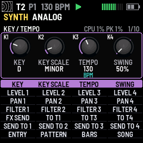 KEY / TEMPO, with the list of pages below.</td><td align="center">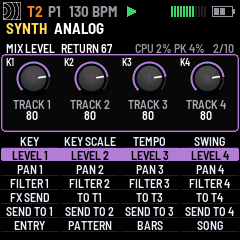 MIX LEVEL.</td><td align="center">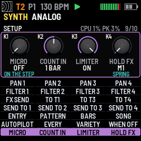 SETUP.</td></tr></table>

<kbd>GLO</kbd> opens ten pages; <kbd>SELECT</kbd> turns them. The list under the knobs shows every page, with the open one lit.

| Page | K1 to K4 |
|---|---|
| KEY / TEMPO | The master key and scale, TEMPO and SWING. Tap tempo: hold <kbd>GLO</kbd> and tap <kbd>PLAY</kbd>. |
| MIX LEVEL | The level of each track. <kbd>ALGO</kbd> is the return level of everything sent to the master effects. |
| MIX PAN | The pan of each track. |
| MIX FILTER | A one-knob filter on each track. |
| SENDS | The chosen track into the master effects (FX SEND), and into each of the other three tracks. |
| SEND TO | Where in the master chain each track's send goes in. |
| SONG | Chains patterns: an entry, its pattern, how many bars, and song mode on or off. |
| AUTOPILOT | Varies the sounds and patterns by itself. See below. |
| SETUP | MICRO (recorded notes keep their exact timing), COUNT IN, the master LIMITER on or off, and HOLD FX, which of the four master effects <kbd>HOME</kbd> + <kbd>K3</kbd> brings in. All four are kept over a power-off. |
| DISPLAY | Colours, the PANEL row style and MIDI SYNC. |

Mute and solo work from anywhere: hold <kbd>ENV</kbd> and press white keys 1 to 4 to mute, black keys 1 to 4 to solo.

## Master, PERFORM and SPECTRUM

<table><tr><td align="center">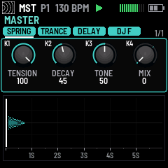 The master chain.</td><td align="center">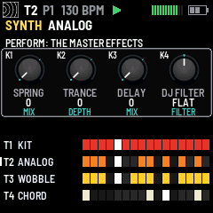 PERFORM.</td><td align="center">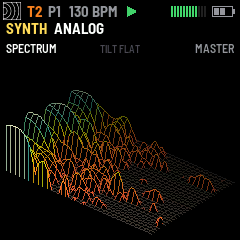 The spectrum.</td></tr></table>

- **MASTER** (<kbd>GLO</kbd> + <kbd>FX</kbd>): four effect slots on the whole mix, then a limiter. It starts with DJ FILTER, REPEAT, TRANCE and REVERB.
- **PERFORM** (<kbd>HOME</kbd> + <kbd>FX</kbd>): the main amount of each master effect on <kbd>K1</kbd> to <kbd>K4</kbd>. Hold <kbd>HOME</kbd> while you turn and the knobs spring back when you let go.
- **Stutter:** while playing, hold <kbd>HOME</kbd> and turn <kbd>K1</kbd> to repeat the current step on every track, or <kbd>K2</kbd> for the chosen track only. More turns set the rate.
- **Hold FX:** hold <kbd>HOME</kbd> and turn <kbd>K3</kbd> to bring one master effect in, as far as you turn; let go of <kbd>HOME</kbd> and it drops back to where it was. HOLD FX on the SETUP page under <kbd>GLO</kbd> chooses which effect.
- **SPECTRUM** (<kbd>GLO</kbd> + <kbd>HOME</kbd>): the sound as a moving 3D landscape. <kbd>K1</kbd> chooses the master or one track, <kbd>K2</kbd> turns the view.

## Patterns, song and presets

<table><tr><td align="center">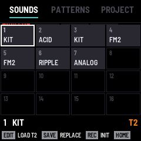 The LIBRARY.</td><td align="center">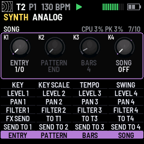 The SONG page.</td></tr></table>

- **Patterns:** hold <kbd>HOME</kbd> and press a white key to go to one of sixteen. It changes at the next bar. With <kbd>SEQ</kbd> held too, the playing pattern is copied there.
- **Song:** the SONG page under <kbd>GLO</kbd> plays patterns in order, each for a number of bars.
- **Sound presets:** hold <kbd>SAVE</kbd> and press a white key to store the sound of the track; hold <kbd>EDIT</kbd> and press the key to load it.
- **Project:** hold <kbd>SAVE</kbd> for most of a second to write everything. It comes back at power-on.
- **LIBRARY** (a tap on <kbd>SAVE</kbd>, or <kbd>SAVE</kbd> + <kbd>EDIT</kbd>): sounds, patterns and the project on one page. <kbd>EDIT</kbd> loads, <kbd>SAVE</kbd> stores, and overwriting asks twice. <kbd>REC</kbd> starts over, the selected track on SOUNDS, every track and the master effects on PROJECT: a box asks first, <kbd>REC</kbd> again is yes, any other button cancels.
- **Start again:** <kbd>SEQ</kbd> + <kbd>SAVE</kbd>, then <kbd>SAVE</kbd> to reset the chosen track, or <kbd>REC</kbd> to reset everything: plain sounds, empty sequences, and no effects on the tracks or the master. Nothing saved is touched until you save.

## Autopilot

AUTOPILOT, under <kbd>GLO</kbd>, keeps changing a playing pattern for you. EVERY sets how often, from 1 to 16 bars. VARIETY sets how much: low values nudge a few knobs, high values redraw lines and swap models. WHEN OFF chooses what happens when you stop it: REVERT puts everything back as you had it, OVERRIDE keeps what is playing. It never touches the mix, mutes, tempo or the master chain.

## LOAD and voices

<table><tr><td align="center">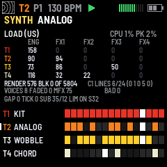 LOAD.</td><td align="center">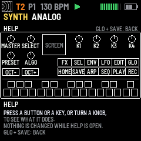 HELP.</td></tr></table>

About eight voices can sound at once. Past that, the least important one fades out; nothing is ever cut with a click. LOAD (<kbd>GLO</kbd> + <kbd>EDIT</kbd>) shows what each track and effect costs and whether any audio was late (XR). If the sound breaks up, lower VOICES on a synth track or remove an effect. On LOAD, <kbd>K1</kbd> sets one or two processor cores, <kbd>K2</kbd> the limiter (the same switch as on SETUP), and <kbd>K4</kbd> pages through the cost of every model and effect.

## MIDI sync

On the DISPLAY page, <kbd>K4</kbd> is MIDI SYNC.

| Setting | What the FM-1 does |
|---|---|
| OFF | Plays on its own. Start and stop from outside still work. |
| SEND | Leads: sends clock, start and stop over USB, through a computer. |
| SEND DIRECT | Leads one other FM-1 plugged straight into its USB port, through a powered hub or adapter. |
| FOLLOW | Follows the tempo and position of the clock coming in. |

## Samples, MIDI and the plugin

The Transfer tab of the PING OS-1 page works with the FM-1 on USB.

- **Samples:** drop up to eight WAV files, name them and send. The bank holds about 4.6 seconds at 32 kHz or 9.2 at 16 kHz. SAMPLE and GRAIN play them.
- **Record:** the FM-1 is a USB audio input, and the page records it to a WAV.
- **Pattern as MIDI:** saves the playing pattern as a MIDI file, a track on each of channels 1 to 4.
- **Project for the plugin:** saves the whole project for the PING OS-1 VST3 plugin, which plays it in a DAW exactly as the FM-1 does.

## Install and uninstall

Connect the FM-1 by USB, open the PING OS-1 page in Chrome or Edge, accept the terms, open Install and press Install. Do not unplug while it writes. The same page puts the stock firmware back. Nothing is sent to any server.

**Back up first.** PING OS-1 keeps its projects, patterns, presets and samples in the memory of the FM-1, in its own format. It does not read what another firmware saved there, and switching firmware in either direction can overwrite what the other one stored. Before you switch, back up with the firmware you are on. From PING OS-1, the Transfer tab saves the project as a file; that file opens in the plugin and cannot yet be sent back to the FM-1.

## Models and effects

Everything a track can hold. On a drum, the two knobs after DECAY change name with the model; they are given in brackets.

### Engines (5)

| Engine | What it is |
|---|---|
| KIT | Eight drums on one track, one on each lane, each with its own model, pitch, decay and level. |
| DRUM | One drum model, played across the lanes as notes. |
| SYNTH | One synth model, up to four notes at once. |
| SAMPLE | One of your eight loaded samples, with start, length, loop, envelope and filter. |
| GRAIN | A loaded sample played as a cloud of grains while a note is held. |

### Synth models (20)

| Model | What it is |
|---|---|
| ANALOG | A two-oscillator subtractive synth: shapes from sine to pulse, sub, noise, a four-mode ladder filter, two ADSR envelopes. |
| FOLD | A wavefolder: a simple wave folded back on itself for bright, buzzy tones (SHAPE, FOLD, ASYM). |
| FM2 | Two-operator FM with feedback: bells, basses, electric pianos (RATIO, INDEX, FEEDBACK). |
| VOICE | A vowel synth that sings A E I O U (VOWEL, SHIFT, BREATH). |
| ADDITIVE | Eight harmonics mixed by hand: where they centre, how wide, odd against even. |
| WAVES | A morphing waveform with bit crush and smoothing (CRUSH, WAVE, SMOOTH). |
| CHORD | A whole chord from one note: eleven chords, inversions, organ or string-machine tone. |
| SWARM | A stack of detuned saws, the supersaw (DETUNE, BRIGHT, JITTER). |
| STRING | A plucked or bowed string, from sitar buzz to piano stiffness (DAMP, BRIGHT, STRUCTURE). |
| MODAL | A struck or bowed resonator, from wood to bell (MATERIAL, BRIGHT, DAMP). |
| BUBBLE | Bubbles in water: one drop a note, or a stream from a drip to a fizz (SPREAD, DENSITY, RING). |
| ACID | A one-voice acid bass with accent and slide (WAVE, ACCENT, DRIVE). |
| NOISE | Tuned, filtered noise for wind, hiss and sweeps (RESO, COLOR, filter type). |
| RIPPLE | A wave-warping synth: one sine bent, folded and re-triggered from the inside (SYNC, FOLD, BEND), with AM and jitter. |
| WOBBLE | The ANALOG voice with a filter sweep locked to the tempo (RATE, DEPTH, SHAPE). |
| ORGAN | A tonewheel organ. |
| PHASE | A phase distortion synth: glassy digital basses and leads. |
| TRIO | Three oscillators with ring modulation and sync into a multimode filter. |
| LOFI | A chip voice: pulse, triangle, saw, noise and tiny wavetables. |
| FM6 | Six-operator FM with eight patches: electric piano, bell, bass, brass, pad, marimba, organ, pluck. |

### Drum models (49)

| Kicks (10) | What it is |
|---|---|
| KICK 808 | The long round analogue kick (SWEEP, HARMONIC). |
| KICK 909 | Punchy and clicky, with a driven body (ATTACK, WAVE). |
| KICK FM | An FM kick, from soft to metallic (RATIO, INDEX). |
| KICK HARD | Folded and gritty, for hard styles (FOLD, GRIT). |
| KICK 606 | Short and light (CLICK, TONE). |
| KICK DEEP | Low and long with a soft punch (PUNCH, WARMTH). |
| KICK SKIN | An acoustic-style kick: a beater on a head (BEATER, DAMP). |
| KICK DUB | Dark with a rumbling tail (RUMBLE, DARK). |
| KICK CLICK | A clean kick with a separate tuned click (CLICK TONE, CLICK LEN). |
| 808 BOOM | The long sub bass drum, playable as a bassline (PUNCH, SATURATE). |

| Snares (7) | What it is |
|---|---|
| SNARE 808 | Two tones and noise (MIX, SNAPPY). |
| SNARE 909 | Brighter and harder, with shaped noise (SPREAD, NOISE TONE). |
| SNARE FM | An FM body under noise (RATIO, NOISE). |
| SNARE MODAL | A drum shell modelled from its resonances (MODES, SNARES). |
| SNARE SKIN | Two heads with wires that rattle (STRIKE, WIRES). |
| SNARE LOFI | A sample-and-hold snare, crunchy (RATE, BITS). |
| SNARE BAND | A body with noise through a band you place and widen (BAND, WIDTH). |

| Claps and wood (5) | What it is |
|---|---|
| CLAP | Several hands and a tail (SPREAD, TAIL). |
| CLAP BAND | A clap whose noise sits in a band you choose (BAND, WIDTH). |
| RIM | A rim shot (BODY, CLICK). |
| CLAVE | A wooden click (WOOD, HARD). |
| COWBELL | Two detuned squares (RATIO, DECAY). |

| Hats (7) | What it is |
|---|---|
| HAT 808 | Six squares through a band: the classic metallic hat (METAL, BAND). |
| HAT NOISE | Filtered noise (RESO, BAND). |
| HAT 606 | Thinner and spitting (SPREAD, BAND). |
| HAT RING | Ring-modulated squares (RATIO, BAND). |
| HAT FM | An FM hat (RATIO, INDEX). |
| HAT CLOCK | Noise clocked at an audible rate (RATE, BAND). |
| HAT WIRE | A short buzzing string fed with noise (BRIGHT, BAND). |

| Cymbals and metal (6) | What it is |
|---|---|
| CYMBAL | Metal and noise (METAL, NOISE). |
| CRASH | A long wash (METAL, WASH). |
| RIDE | A ping with a sizzle and a bell (BELL, SIZZLE). |
| RIDE 808 | The 808 cymbal voiced long (METAL, BAND). |
| RIDE 909 | A gritty, low-rate ride (BELL, GRIT). |
| METAL | FM for gongs, bells and trashy cymbals (RATIO, SPREAD). |

| Skins and shakers (4) | What it is |
|---|---|
| TOM | A swept tom (SWEEP, SKIN). |
| CONGA | Open, slapped or muted (SLAP, MUTE). |
| MEMBRANE | A struck drum head (STRIKE, DAMP). |
| SHAKER | Grains in a shell (DENSITY, RESO). |

| Tuned (6) | What it is |
|---|---|
| BELL | A struck bell or bar (MATERIAL, POSITION). |
| PLUCK | A plucked string that can turn into a drum (BRIGHT, DRUM). |
| PING | A sine blip with a sub (SWEEP, SUB). |
| IMPULSE | A tuned tick: a strike through a comb (HARD, DAMP). |
| FM PERC | A pitched FM hit (RATIO, INDEX). |
| FM THUMP | A low FM thump (RATIO, FM AMT). |

| Noise and digital (4) | What it is |
|---|---|
| NOISE PERC | A burst of noise through a swept band (SWEEP, RESO). |
| ZAP | A laser sweep (SWEEP, FEEDBACK). |
| BIT | A chip hit, tone against noise (NOISE, TONE MIX). |
| GLITCH | Digital chaos (CHAOS, RATE). |

### Effects (23)

| Effect | What it does |
|---|---|
| FILTER | Low, high, band pass or notch, 12 or 24 dB. |
| DJ FILTER | One knob: left closes a low pass, right opens a high pass. |
| DISPERSE | Smears a hit in time into a chirp or a zap. |
| COMB | Rings at a pitch and its harmonics. The pitch can follow the notes of a track. |
| PHASER | 2, 4, 6 or 8 poles, with a choice of sweep shape. |
| FLANGER | A swept short delay with feedback. |
| TREMOLO | Level sweep; with STEREO, an auto-pan. |
| CHORUS | A swept voice on each side. |
| UNISON | Two, four or six detuned copies of any sound, spread left and right. |
| DELAY | Stereo, synced or free, with ping pong. |
| DUB DELAY | A resonant filter in the feedback that can sweep and run away. |
| ECHO | Tape echo: dark, saturating repeats. |
| CRYSTAL | Pitch-shifted grains fed back, so each repeat climbs. |
| REVERB | HALL, ROOM, PLATE or GATED, with DUCK to dip it under the dry sound. |
| SPRING | Two springs, left and right. |
| ERODE | Grit and air: a tiny delay shaken by noise or a sine. |
| VINYL | Crackle, pops and dust. |
| TAPE | Wow, saturation and hiss. |
| RESONATOR | Four tuned bands that follow the master key. |
| DRIVE | Five distortion curves and a bit crusher, with tone, clip and gate. |
| TRANCE | A sixteen-step gate in time with the sequencer. While its page is open the white keys are its steps. |
| REPEAT | Beat repeat: grabs a slice every bar or beat and repeats it. |
| SIDECHAIN | Ducks the track under another track, or under one drum of a kit. |

## Shortcuts

| Combination | Result |
|---|---|
| <kbd>SEQ</kbd> + a knob | That knob's mode |
| <kbd>SEQ</kbd> + <kbd>ENV</kbd> | Envelope display |
| <kbd>SEQ</kbd> + <kbd>K1</kbd> to <kbd>K4</kbd> (STEP) | Length, rate, direction, swing |
| <kbd>SEQ</kbd> + <kbd>ALGO</kbd> | Scale. In TRACKS: tempo |
| <kbd>SEQ</kbd> + <kbd>REC</kbd> | Clear the track (STEP), the pattern (TRACKS), the song (SONG) |
| <kbd>SEQ</kbd> + <kbd>SAVE</kbd> | INIT: then <kbd>SAVE</kbd> for the track, <kbd>REC</kbd> for everything |
| <kbd>REC</kbd> in the LIBRARY | INIT, after a yes: the track on SOUNDS, everything on PROJECT |
| <kbd>SEQ</kbd> + white 12 to 16 | Generators |
| <kbd>EDIT</kbd> + <kbd>OCT+</kbd> / <kbd>OCT-</kbd> | Step knobs, second page / first page |
| <kbd>EDIT</kbd> + <kbd>REC</kbd> | Undo, redo |
| <kbd>EDIT</kbd> + <kbd>ALGO</kbd>, <kbd>SELECT</kbd> | Track key, track scale |
| <kbd>EDIT</kbd> + white 1 to 16 | Load a sound preset |
| <kbd>SAVE</kbd> + white 1 to 16 | Store a sound preset |
| <kbd>SAVE</kbd> tap, hold | LIBRARY, save the project |
| <kbd>HOME</kbd> + white 1 to 16 | Pattern |
| <kbd>HOME</kbd> + <kbd>SEQ</kbd> + white | Copy the pattern there |
| <kbd>HOME</kbd> + <kbd>K1</kbd>, <kbd>K2</kbd> | Stutter: all tracks, this track |
| <kbd>HOME</kbd> + <kbd>K3</kbd> | Hold FX: a master effect in while <kbd>HOME</kbd> is held |
| <kbd>HOME</kbd> + <kbd>FX</kbd> | PERFORM |
| <kbd>HOME</kbd> + <kbd>ARP</kbd>, <kbd>SEQ</kbd> + <kbd>ARP</kbd> | A new line without leaving TRACKS or STEP |
| <kbd>GLO</kbd> + <kbd>FX</kbd> | MASTER |
| <kbd>GLO</kbd> + <kbd>HOME</kbd> | SPECTRUM |
| <kbd>GLO</kbd> + <kbd>EDIT</kbd> | LOAD |
| <kbd>GLO</kbd> + <kbd>SAVE</kbd> | HELP |
| <kbd>GLO</kbd> + <kbd>PLAY</kbd> taps | Tap tempo |
| <kbd>LFO</kbd> + a knob | Map the chosen modulator |
| <kbd>LFO</kbd> + white 1 to 4 | Choose the modulator |
| <kbd>LFO</kbd> + <kbd>REC</kbd> | Clear its mappings |
| <kbd>ENV</kbd> + white 1 to 4, black 1 to 4 | Mute, solo |
| <kbd>SEL</kbd> + <kbd>ALGO</kbd> | Track level |
| <kbd>OCT-</kbd> + <kbd>OCT+</kbd> | Macros on the knobs |
| <kbd>REC</kbd> + steps | Arm steps for locks |
| <kbd>REC</kbd> held and let go | Metronome |
| Step held + later step | Tie |
| Step held + black keys | Chord |

## Credits and licence

PING OS-1 is open source under the Mozilla Public License 2.0. It is built on fm1-base and felucca-bsp. FOLD, VOICE, CHORD, STRING and MODAL are ports of Mutable Instruments Plaits; ORGAN, PHASE, TRIO, LOFI and FM6 come from Felucca by Leo Kuroshita, FM6 after msfa. Full notices are in docs/THIRD_PARTY.md. Jost by indestructible type, SIL Open Font License.

PING OS-1 is not made or endorsed by M-VAVE. It is provided as is, with no warranty; you install it at your own risk.
